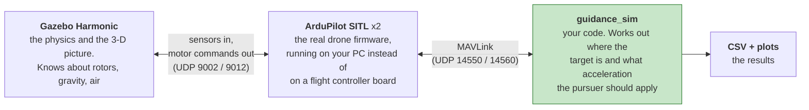

# Setup guide — from a blank Ubuntu machine to a flying engagement

This guide assumes **you have installed nothing** and have never used ROS, Gazebo or
ArduPilot. Every command is written out in full. After each step there is a **Check it
worked** box — do not move on until that check passes, because every later step depends on
the earlier ones.

Total time: **60–90 minutes**, most of it waiting for downloads and compiles.
Disk space needed: **about 20 GB**.

- Just want the commands, already set up? → [COMMANDS.md](COMMANDS.md)
- Want to know *why* it works this way? → [GUIDE.md](GUIDE.md)
- Want the architecture and where to take it next? → [WORKSPACE_HANDOFF.md](WORKSPACE_HANDOFF.md)

---

## 0. What you are building

Two quadcopters in a simulator. One is the **pursuer**, one is the **target**. The pursuer
chases the target using a classical guidance law (pure pursuit, proportional navigation,
and six others), and you measure whether it hits and how hard it had to manoeuvre.

Four separate programs cooperate to do this:



In plain terms: **Gazebo** is the world, **ArduPilot SITL** is the autopilot brain of each
drone, and **guidance_sim** is the chase logic you are studying. They talk over network
ports on your own machine.

So you need to install all four pieces. That is what the rest of this guide does.

---

## 1. Before you start

**You must be on Ubuntu 22.04 (Jammy).** Check:

```bash
lsb_release -a
```

You need to see `Release: 22.04`. If you are on 24.04, 20.04, Windows or macOS, **stop** —
the version numbers in this guide will not work. ROS 2 Humble only supports 22.04. Install
Ubuntu 22.04 in a virtual machine or dual boot first.

> **Virtual machine warning:** Gazebo needs real 3-D graphics. In VirtualBox or VMware you
> must enable 3-D acceleration and give the VM at least 4 CPU cores and 8 GB of RAM, or
> Gazebo will either crash or run at a tenth of real speed. A native install is much better.

**A note on typing commands.** Everything in a grey box is one command — copy the whole
box, paste it into a terminal, press Enter. Open a terminal with `Ctrl+Alt+T`. When a
command starts with `sudo` it will ask for your password; you will see nothing as you type
it, which is normal.

---

## 2. Step 1 — Install ROS 2 Humble

ROS 2 is the robotics framework that ties the pieces together. Here it provides the build
tool (`colcon`) and the launcher (`ros2 launch`).

Enable the Ubuntu software sources ROS needs:

```bash
sudo apt update && sudo apt install -y software-properties-common curl && sudo add-apt-repository -y universe
```

Add the ROS 2 package repository and its signing key:

```bash
sudo curl -sSL https://raw.githubusercontent.com/ros/rosdistro/master/ros.key -o /usr/share/keyrings/ros-archive-keyring.gpg && echo "deb [arch=$(dpkg --print-architecture) signed-by=/usr/share/keyrings/ros-archive-keyring.gpg] http://packages.ros.org/ros2/ubuntu $(. /etc/os-release && echo $UBUNTU_CODENAME) main" | sudo tee /etc/apt/sources.list.d/ros2.list > /dev/null
```

Install ROS 2 Humble and the build tools. **This downloads about 2 GB and takes 10–20
minutes.**

```bash
sudo apt update && sudo apt install -y ros-humble-desktop ros-dev-tools python3-colcon-common-extensions
```

Make ROS available in every new terminal from now on:

```bash
echo 'source /opt/ros/humble/setup.bash' >> ~/.bashrc && source ~/.bashrc
```

> **Check it worked**
> ```bash
> printenv ROS_DISTRO
> ```
> Must print `humble`. If it prints nothing, close the terminal, open a new one, and try
> again. If still nothing, the `echo ... >> ~/.bashrc` line did not run — repeat it.

If the install steps above fail, the official instructions are the authority and are
occasionally updated: <https://docs.ros.org/en/humble/Installation/Ubuntu-Install-Debs.html>

---

## 3. Step 2 — Install Gazebo Harmonic

Gazebo is the simulator: physics, rotors, gravity and the 3-D view.

> **Important:** install **Harmonic**, not Fortress. Ubuntu 22.04's default pairing with
> ROS Humble is Fortress, but this project needs Harmonic because the ArduPilot plugin and
> the world files use Harmonic features. Mixing them is the single most common way to get
> stuck here.

Add the Gazebo repository and key:

```bash
sudo apt-get update && sudo apt-get install -y curl lsb-release gnupg && sudo curl https://packages.osrfoundation.org/gazebo.gpg --output /usr/share/keyrings/pkgs-osrf-archive-keyring.gpg && echo "deb [arch=$(dpkg --print-architecture) signed-by=/usr/share/keyrings/pkgs-osrf-archive-keyring.gpg] http://packages.osrfoundation.org/gazebo/ubuntu-stable $(lsb_release -cs) main" | sudo tee /etc/apt/sources.list.d/gazebo-stable.list > /dev/null
```

Install it (**another ~1 GB**):

```bash
sudo apt-get update && sudo apt-get install -y gz-harmonic
```

> **Check it worked**
> ```bash
> gz sim --versions
> ```
> Must print a version starting with `8`, for example `8.15.0`. The `8` is what matters —
> Gazebo 8 *is* Harmonic.

Try the simulator on its own, to prove your graphics work:

```bash
gz sim -v4 shapes.sdf
```

A window should open with some shapes. Press the **play ▶** button at the bottom left and
they should fall. Close the window when satisfied. If it never opens or the window is
black, your graphics drivers or VM 3-D acceleration are the problem — fix that now, because
nothing later will work without it.

---

## 4. Step 3 — Install the plugin's build dependencies

The ArduPilot–Gazebo bridge is a C++ plugin that you compile yourself in step 6. These are
the libraries it needs:

```bash
sudo apt update && sudo apt install -y libgz-sim8-dev rapidjson-dev libopencv-dev libgstreamer1.0-dev libgstreamer-plugins-base1.0-dev gstreamer1.0-plugins-bad gstreamer1.0-libav gstreamer1.0-gl
```

Tell the plugin's build system which Gazebo you have. **This must be set before you build,
or the build fails with a confusing `Unsupported GZ_VERSION` error:**

```bash
echo 'export GZ_VERSION=harmonic' >> ~/.bashrc && source ~/.bashrc
```

> **Check it worked**
> ```bash
> printenv GZ_VERSION
> ```
> Must print `harmonic`.

---

## 5. Step 4 — Get the project code

Clone the repository into a folder called `guidance_ws` in your home directory. **Use this
exact folder name** — the launch files contain the path `~/guidance_ws`, so a different
name means editing files later.

```bash
cd ~ && git clone https://github.com/Karthik-227/Guidance--Pure-Pursuit-GZ-sim.git guidance_ws
```

> **Check it worked**
> ```bash
> ls ~/guidance_ws/src/guidance_sim
> ```
> You should see `guidance_sim`, `config`, `worlds`, `models`, `launch`, `setup.py` and
> some `.md` files. If you get "No such file or directory", the clone went somewhere else —
> check for a folder named `Guidance--Pure-Pursuit-GZ-sim` in your home directory.

`src/` is where ROS workspaces keep source code. Right now it holds only `guidance_sim`
(the project's own code). The next two steps add the two big external pieces next to it.

---

## 6. Step 5 — Install ArduPilot and build SITL

ArduPilot is real drone autopilot firmware. **SITL** ("software in the loop") is that same
firmware compiled to run on your PC, so each simulated drone has a genuine autopilot
rather than a simplified model.

Clone it inside `src/`. The `--recurse-submodules` part matters — ArduPilot is built from
many sub-repositories and the build fails without them. **This downloads about 1 GB:**

```bash
cd ~/guidance_ws/src && git clone --recurse-submodules https://github.com/ArduPilot/ardupilot.git
```

Run ArduPilot's own dependency installer. It installs compilers and Python packages,
including `pymavlink` and `MAVProxy` which this project needs:

```bash
cd ~/guidance_ws/src/ardupilot && Tools/environment_install/install-prereqs-ubuntu.sh -y
```

Reload your shell so the newly installed tools are on your PATH:

```bash
source ~/.profile
```

Now compile the copter simulator. **This takes 10–20 minutes** and prints a great deal of
output:

```bash
cd ~/guidance_ws/src/ardupilot && ./waf configure --board sitl && ./waf copter
```

> **Check it worked**
> ```bash
> ls -la ~/guidance_ws/src/ardupilot/build/sitl/bin/arducopter
> ```
> The file must exist and be several megabytes. That file is the drone's brain; this
> project runs two copies of it.

Finally, tell the ROS build tool to **skip** ArduPilot. ArduPilot contains some ROS
packages of its own that this project does not use, and building them pulls in extra
dependencies you do not need:

```bash
touch ~/guidance_ws/src/ardupilot/COLCON_IGNORE
```

This does not affect the SITL binary you just built — only what `colcon build` tries to
compile. Skipping it saves a long build and avoids the Micro-XRCE-DDS setup entirely.

---

## 7. Step 6 — Install the ArduPilot–Gazebo plugin

This is the bridge: it sends Gazebo's sensor readings to ArduPilot and applies ArduPilot's
motor commands to the Gazebo model. Without it the two never meet.

```bash
cd ~/guidance_ws/src && git clone https://github.com/ArduPilot/ardupilot_gazebo.git
```

You do **not** build it by hand — the workspace build in step 9 does it for you, and that
way the Gazebo plugin paths get set automatically whenever you source the workspace.

> **Check it worked**
> ```bash
> ls ~/guidance_ws/src/ardupilot_gazebo/src/ArduPilotPlugin.cc
> ```
> The file must exist.

---

## 8. Step 7 — Install the Python packages

The guidance code uses these for maths and plotting:

```bash
pip3 install --user numpy scipy matplotlib pymavlink MAVProxy
```

> **Check it worked**
> ```bash
> python3 -c "import numpy, scipy, matplotlib, pymavlink; print('all present')"
> ```
> Must print `all present`. If a module is missing, re-run the `pip3` line and read its
> output for errors.

---

## 9. Step 8 — Build the workspace

Two builds, in this order. The plugin first, because the project depends on it:

```bash
cd ~/guidance_ws && colcon build --packages-select ardupilot_gazebo
```

This compiles C++ and takes a few minutes. Then the project itself, which is Python and
takes seconds:

```bash
cd ~/guidance_ws && colcon build --packages-select guidance_sim --symlink-install
```

Make the workspace available in new terminals:

```bash
echo 'source ~/guidance_ws/install/setup.bash' >> ~/.bashrc && source ~/.bashrc
```

> **Check it worked**
> ```bash
> ros2 run guidance_sim offline --law pn --lam0 30 --gam-t 200 -o /tmp/test.csv
> ```
> This runs the *offline* simulator — no Gazebo, no autopilot, pure maths — and should
> print one line in about a second, ending in something like:
> ```
> pn               hit      miss=   0.91 m  t_f= 28.76 s  peak|latax|= 0.63 m/s^2
> ```
> **If you see that line, the code and the build are correct.** Everything from here on is
> about the simulator, not the code.

If instead you see `ros2 run: executable not found`, the workspace is not sourced — open a
new terminal and try again.

---

## 10. Step 9 — Your first flying engagement

You need **two terminals** side by side. Terminal A runs the simulator and stays running
for as long as you are working. Terminal B is where you type commands.

### Terminal A — start the simulator

```bash
cd ~/guidance_ws && source install/setup.bash && ros2 launch guidance_sim engagement.launch.py
```

A Gazebo window opens showing one quadcopter on a green plain. A lot of text scrolls past.

**Wait for `AP: ArduPilot Ready` to appear twice** — once for each drone. This takes about
30 seconds. The launch starts Gazebo, then the first autopilot 6 seconds later, then the
second at 12 seconds, so that nothing races.

> **You will only see one drone.** The second is 500 m away — about one pixel on the
> horizon. That is correct, not a bug. To look at it: find `iris_target` in the **Entity
> Tree** panel on the left, right-click it, choose **Move to**.

If you want to confirm both exist, open a third terminal and run:

```bash
gz model --list
```

You should see `ground_plane`, `axes`, `iris_pursuer` and `iris_target`.

### Terminal B — launch both drones

```bash
cd ~/guidance_ws && source install/setup.bash && ros2 run guidance_sim takeoff_both --alt 50
```

Both drones arm and climb to 50 m together. Expect:

```
[pursuer] mode GUIDED
[target] mode GUIDED
[pursuer] armed
[target] armed
[pursuer] takeoff commanded to 50 m
[target] takeoff commanded to 50 m
[pursuer] at 50.0 m
[target] at 50.0 m
[run] both airborne: pursuer 50.0 m, target 50.0 m
```

### Terminal B — fly the chase

```bash
cd ~/guidance_ws && source install/setup.bash && ros2 run guidance_sim engage --law pn --vp 12 --alt 50 --vt 6 --gam-t 180 -o runs/sitl_pn.csv
```

Watch the Gazebo window: the pursuer accelerates, turns onto an intercept course and
closes on the target. In Terminal B a status line prints every second:

```
     t      R     Rdot      Vp     Vt   lamdot    latax   alt_p  alt_t
   0.0   500.8   -5.98   12.01   6.00   0.0121    0.223    50.0   50.0
   1.0   494.8   -6.01   12.00   6.00   0.0118    0.214    50.0   50.0
```

Reading that table:

| column | meaning |
|---|---|
| `t` | seconds since guidance started |
| `R` | **range** — distance between the two drones, metres |
| `Rdot` | how fast the range is changing. **Negative = closing in. This is the one to watch** |
| `Vp` / `Vt` | speed of pursuer / target, m/s |
| `lamdot` | how fast the line of sight is rotating. Proportional navigation works by driving this to zero |
| `latax` | sideways acceleration the pursuer is being asked for, m/s² |
| `alt_p` / `alt_t` | altitude of each, metres |

It ends with a summary:

```
pn               hit      miss=   1.42 m  t_f= 29.10 s  peak|latax|= 0.71 m/s^2  mean= 0.44  dv=  12.3 m/s
wrote runs/sitl_pn.csv (1455 rows, 48.6 Hz achieved)
```

`hit` means it intercepted. `miss` is how close it got. **You have just flown a complete
guidance engagement.**

### Terminal B — land, and see the results

```bash
cd ~/guidance_ws && source install/setup.bash && ros2 run guidance_sim land_both
```

```bash
cd ~/guidance_ws && source install/setup.bash && ros2 run guidance_sim plot_run runs/sitl_pn.csv --show
```

Five graphs appear: the paths from above, range against time, line-of-sight rate,
sideways acceleration against its limit, and heading error.

### Starting again

To re-run: stop Terminal A with `Ctrl+C`, wait for it to exit fully, then start it again
and repeat from `takeoff_both`. You cannot run two engagements without landing and
re-taking off, and you cannot start a second Gazebo while the first is alive.

---

## 11. Changing things

This is the part you will use most. **Everything in `worlds/`, `models/`, `config/` and
`launch/` needs a rebuild to take effect; Python files do not.** When in doubt, rebuild:

```bash
cd ~/guidance_ws && colcon build --packages-select guidance_sim --symlink-install
```

### Quick reference

| What you want to change | Where | Rebuild? |
|---|---|---|
| Target's **starting position** | `src/guidance_sim/worlds/engagement.sdf` | **Yes** |
| Target's **speed** | `--vt` on the command line | No |
| Target's **heading** | `--gam-t` on the command line | No |
| Target **manoeuvring** | `--target turn\|weave --at 3` | No |
| Pursuer's **speed** | `--vp` on the command line | No |
| **Which guidance law** | `--law` on the command line | No |
| **Gains** (`N`, `k`) | `-N`, `-k` on the command line | No |
| **Altitude** | `--alt` on the command line | No |
| **Acceleration limit** | `--a-max` + `ANGLE_MAX` in `config/sitl_guided.parm` | Yes, for the `.parm` |
| Autopilot parameters | `src/guidance_sim/config/sitl_guided.parm` | **Yes** |

### Changing the target's starting position

Open the world file:

```bash
gedit ~/guidance_ws/src/guidance_sim/worlds/engagement.sdf
```

Near the bottom, find:

```xml
<include>
  <uri>model://iris_target</uri>
  <name>iris_target</name>
  <pose degrees="true">500 0 0.195 0 0 180</pose>
</include>
```

The six numbers in `<pose>` are `X Y Z roll pitch yaw`:

| position | number | meaning |
|---|---|---|
| 1st | `500` | metres **East** — *this is the distance knob* |
| 2nd | `0` | metres **North** |
| 3rd | `0.195` | height. **Leave this alone** — it is the drone's landing-gear clearance; make it smaller and the drone starts inside the ground |
| 4th, 5th | `0 0` | roll, pitch — leave at 0 |
| 6th | `180` | which way it faces, in degrees |

> **Why is East the first number?** Gazebo measures *x = East, y = North* (called ENU).
> ArduPilot and all the guidance maths use *North, East, Down* (NED). The plugin converts
> between them. So Gazebo's first number ends up being East in the guidance code. This
> catches everyone once.

Examples:

- **Target 800 m east:** `<pose degrees="true">800 0 0.195 0 0 180</pose>`
- **Target 500 m north instead:** `<pose degrees="true">0 500 0.195 0 0 180</pose>`
- **Target 300 m north-east:** `<pose degrees="true">212 212 0.195 0 0 180</pose>`

Save the file, then **rebuild**, then restart Terminal A:

```bash
cd ~/guidance_ws && colcon build --packages-select guidance_sim --symlink-install
```

> **Do not change `--custom-location` in the launch file.** Both drones must share the same
> "home" GPS position or their position reports cannot be compared, and the engagement will
> look plausible while being wrong.

### Changing speeds, headings and the law

These are command-line flags — no file editing, no rebuild:

```bash
# faster target, running north-east instead of south
cd ~/guidance_ws && source install/setup.bash && ros2 run guidance_sim engage --law pn --vp 12 --vt 10 --gam-t 45 --alt 50 -o runs/fast_target.csv
```

```bash
# pure pursuit instead of proportional navigation
cd ~/guidance_ws && source install/setup.bash && ros2 run guidance_sim engage --law pure_pursuit -k 2 --vp 12 --vt 6 --alt 50 -o runs/pp.csv
```

```bash
# a target that weaves, to make the chase hard
cd ~/guidance_ws && source install/setup.bash && ros2 run guidance_sim engage --law apn --vp 12 --vt 6 --target weave --at 3 --weave-period 8 --alt 50 -o runs/weave.csv
```

What the main flags mean:

| flag | meaning | typical |
|---|---|---|
| `--law` | which guidance law. `pure_pursuit`, `deviated_pursuit`, `constant_bearing`, `pn`, `ppn`, `apn`, `zem`, `los` | `pn` |
| `--vp` | pursuer speed, m/s | 12 |
| `--vt` | target speed, m/s | 6 |
| `--gam-t` | target heading, degrees from North (180 = flying south, straight at you) | 180 |
| `-N` | navigation ratio for the PN family. Must exceed 2 to catch anything | 3–5 |
| `-k` | gain for the pursuit family | 2 |
| `--alt` | altitude for both drones, m | 50 |
| `--target` | `straight`, `turn` or `weave` | `straight` |
| `--at` | how hard the target manoeuvres, m/s² | 0–3 |
| `--status` | seconds between status lines; `0` silences them | 1 |

**Rule of thumb:** `--vp` greater than `--vt` and the pursuer can catch up. Make `--vt`
larger than `--vp` and pure pursuit will never catch it while proportional navigation
still might — that contrast is one of the most interesting results this project produces.

### Test ideas without the simulator at all

The *offline* simulator runs the identical guidance code as pure maths — no Gazebo, no
autopilot — in about a second. Use it to try things before spending five minutes on a
flown run:

```bash
cd ~/guidance_ws && source install/setup.bash && ros2 run guidance_sim offline --law pn --r0 500 --lam0 90 --gam-t 180 --vp 12 --vt 6 -o runs/pn_offline.csv
```

Here the geometry is flags rather than a world file: `--r0` is the starting distance and
`--lam0` is the direction to the target in degrees from North (**use 90 to match the
simulator, because the target starts East**).

Compare a flown run against the offline prediction of the same setup:

```bash
cd ~/guidance_ws && source install/setup.bash && ros2 run guidance_sim plot_run runs/sitl_pn.csv runs/pn_offline.csv --show
```

---

## 12. When something goes wrong

Find your error message below. These are all real failures seen while bringing this
project up.

### `ros2: command not found`

ROS is not loaded in this terminal.

```bash
source /opt/ros/humble/setup.bash
```

If that fixes it, the line is missing from `~/.bashrc` — redo the last part of Step 1.

### `ros2 run: executable not found` or `Package 'guidance_sim' not found`

The workspace is not loaded, or not built.

```bash
cd ~/guidance_ws && source install/setup.bash
```

Still failing? Rebuild: `cd ~/guidance_ws && colcon build --packages-select guidance_sim --symlink-install`

### `PreArm: Motors: Check frame class and type`, and the drones will not arm

The autopilot does not know what shape of aircraft it is. Two causes:

1. `FRAME_CLASS` and `FRAME_TYPE` are missing from `config/sitl_guided.parm`. They must be
   there — recent ArduPilot does not supply them automatically for this kind of simulation.
2. Old saved settings are overriding the file. Clear them:

```bash
cd ~/guidance_ws && rm -f sitl_state/pursuer/eeprom.bin sitl_state/target/eeprom.bin
```

Then rebuild and restart Terminal A.

### `waiting for heartbeat on udp:127.0.0.1:14550 ...` and it never continues

Nothing is sending data on that port — the simulator is not running. Check:

```bash
pgrep -af 'arducopter|sim_vehicle.py' | head
```

- **Nothing listed:** Terminal A has died or was closed. Restart it and wait for
  `ArduPilot Ready` twice.
- **Listed, but still no heartbeat:** an old command is still holding the port. Find it
  with `ss -lunp | grep 1455` and close that terminal.

### The drone spins slowly on the spot and never chases

It has no forward speed, and **no guidance law can create speed** — they only steer a drone
that is already moving. Make sure you pass `--vp`:

```bash
ros2 run guidance_sim engage --law pn --vp 12 --alt 50 -o runs/test.csv
```

You should see `[run] accelerating pursuer to 12 m/s` and then `[run] pursuer at 11.8 m/s`
before the chase starts. If that speed comes out near zero, the drone is not getting
airspeed authority — check `WPNAV_SPEED` and `ANGLE_MAX` in `config/sitl_guided.parm`.

### `Rdot` stays positive the whole run

The range is growing, so it is not chasing. Usually the above `--vp` problem, or the target
is faster than the pursuer (`--vt` > `--vp`).

### Gazebo opens a black window, or crashes immediately

Graphics. On a virtual machine, enable 3-D acceleration and give it more RAM. On a laptop
with switchable graphics, force the dedicated GPU. Test in isolation with
`gz sim -v4 shapes.sdf` — if that fails, no project setting will help.

### `Unsupported GZ_VERSION` when building

```bash
echo 'export GZ_VERSION=harmonic' >> ~/.bashrc && source ~/.bashrc
```

Then delete the failed build and retry:

```bash
cd ~/guidance_ws && rm -rf build/ardupilot_gazebo install/ardupilot_gazebo && colcon build --packages-select ardupilot_gazebo
```

### I edited a world / model / `.parm` file and nothing changed

Those files are *copied* into `install/` during the build, and the simulator reads the copy.
Rebuild, then restart Terminal A:

```bash
cd ~/guidance_ws && colcon build --packages-select guidance_sim --symlink-install
```

### Everything is broken and I want to start the build again

Safe — it only deletes compiled output, never your source code:

```bash
cd ~/guidance_ws && rm -rf build install log && colcon build --packages-select ardupilot_gazebo && colcon build --packages-select guidance_sim --symlink-install
```

---

## 13. Using git with this project

### What belongs in the repository

**Only your own code and documents.** Not ArduPilot, not the plugin, not build output —
those are other people's repositories and gigabytes of compiled files. Anyone setting up
clones them separately in Steps 5 and 6, which is exactly what this guide does.

Create a `.gitignore` in `~/guidance_ws` containing:

```gitignore
# Build output — regenerated by colcon, never committed
build/
install/
log/

# External repositories, cloned separately per SETUP.md Steps 5 and 6
src/ardupilot/
src/ardupilot_gazebo/
Micro-XRCE-DDS-Gen/

# Simulator state and flight logs
sitl_state/
logs/
ros_gz_logs/
runs/
terrain/
*.tlog
*.tlog.raw
*.BIN
*.parm.bak
eeprom.bin*

# Python
__pycache__/
*.pyc

# Editor
.vscode/
```

So the repository holds:

```
guidance_ws/
├── SETUP.md              this guide
├── COMMANDS.md           command reference
├── GUIDE.md              bring-up and troubleshooting
├── WORKSPACE_HANDOFF.md  architecture
├── .gitignore
├── computer_assignment/  the standalone coursework scripts
└── src/guidance_sim/     the package: code, worlds, models, config, launch
```

### Pushing your changes

```bash
cd ~/guidance_ws && git add -A && git status
```

Read what `git status` lists. If it mentions `build/`, `install/` or `src/ardupilot`, your
`.gitignore` is not working — fix it before committing, or you will push a gigabyte.

```bash
cd ~/guidance_ws && git commit -m "describe what you changed" && git push
```

### Getting someone else's changes

```bash
cd ~/guidance_ws && git pull && colcon build --packages-select guidance_sim --symlink-install
```

**Always rebuild after pulling.** Someone else's change to a world or config file will do
nothing until you do.

---

## 14. Summary — the whole thing on one page

Once set up, a working session is only this:

```bash
# Terminal A (leave running)
cd ~/guidance_ws && source install/setup.bash && ros2 launch guidance_sim engagement.launch.py
```

```bash
# Terminal B — after "ArduPilot Ready" appears twice
cd ~/guidance_ws && source install/setup.bash && ros2 run guidance_sim takeoff_both --alt 50
```

```bash
# Terminal B
cd ~/guidance_ws && source install/setup.bash && ros2 run guidance_sim engage --law pn --vp 12 --alt 50 --vt 6 --gam-t 180 -o runs/sitl_pn.csv
```

```bash
# Terminal B
cd ~/guidance_ws && source install/setup.bash && ros2 run guidance_sim land_both
```

```bash
# Terminal B — look at the results
cd ~/guidance_ws && source install/setup.bash && ros2 run guidance_sim plot_run runs/sitl_pn.csv --show
```

Install steps, in order, if you ever need to redo them: ROS 2 Humble → Gazebo Harmonic →
plugin dependencies + `GZ_VERSION` → clone this repo → ArduPilot + `./waf copter` →
clone `ardupilot_gazebo` → Python packages → `colcon build` twice.


