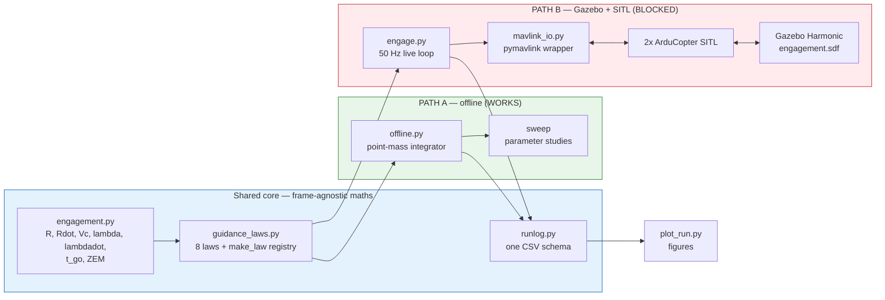
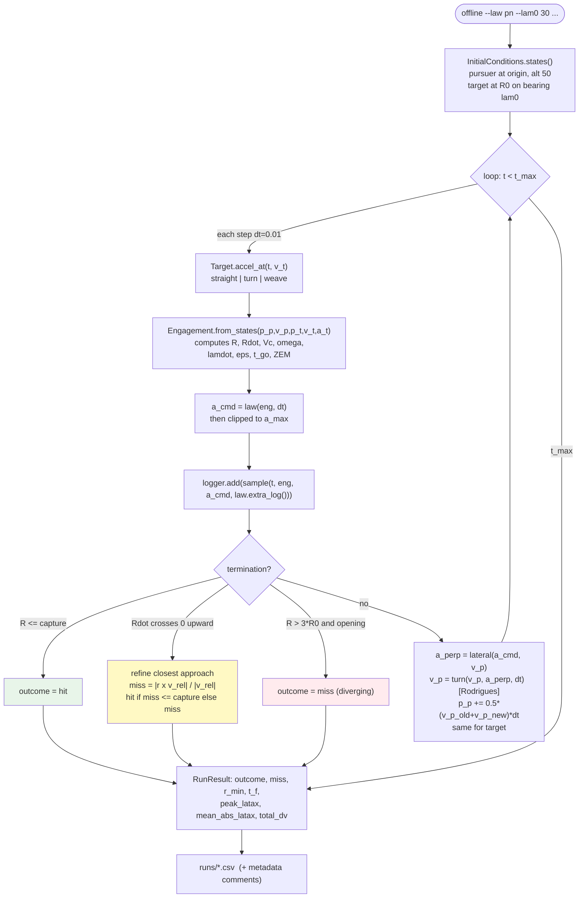
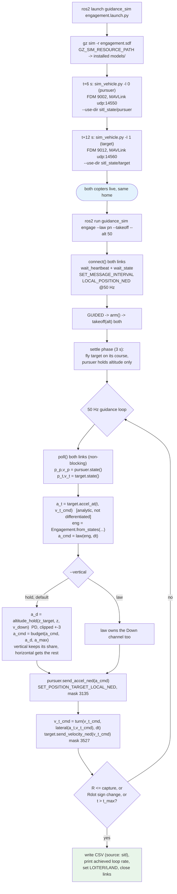
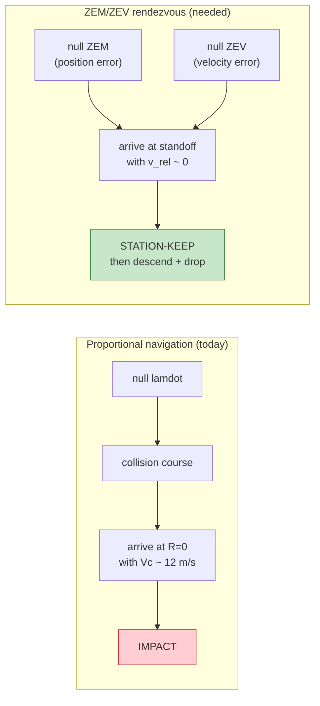
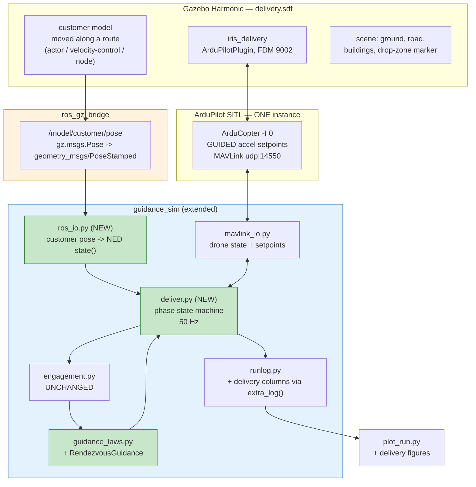
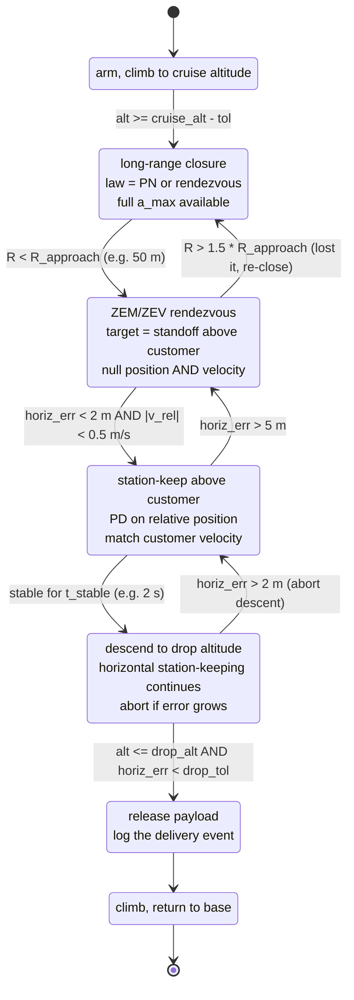
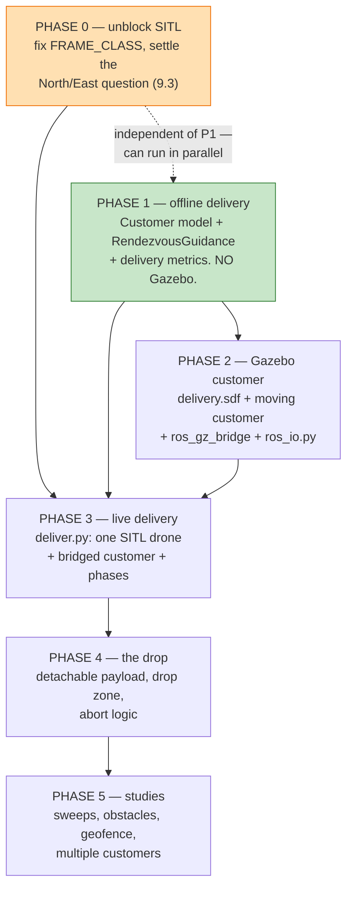

# guidance_ws — Workspace Build, Current State, and Path to a Delivery-Drone Simulation

**Audience:** a developer or an LLM agent picking this workspace up cold.
**Written:** 2026-11-05. **Host:** Ubuntu (kernel 6.8), ROS 2 Humble, Gazebo Harmonic 8.15.0.
**Root:** `/home/karthik/guidance_ws` — **not** a git repository (no version control; be careful, there is no undo).

---

## 0. TL;DR for an agent arriving cold

| Question | Answer |
|---|---|
| What is this? | A **pursuit–evasion (missile guidance) testbed** for IIT Madras course AS5570: two quadcopters, a pursuer chasing a target, eight classical guidance laws. |
| What does the user want next? | To turn it into a **delivery-drone simulation**: a drone that rendezvouses with a **moving customer**. |
| What works today? | **The offline point-mass simulator (Path A) works and is verified.** It is the fast loop — seconds per run. |
| What does not work? | **The Gazebo + ArduPilot SITL path (Path B) has never flown an engagement end to end.** It dies at arming. Root cause is identified in §9.1. |
| Biggest conceptual change needed for delivery | Interception ≠ delivery. Hitting at 2 m with 12 m/s of closing speed is a crash. Delivery needs **rendezvous**: zero relative position *and* zero relative velocity. See §11 — it is a new guidance law, not a tuning change. |
| Where should work start? | **Path A first, always.** Add the customer motion model and the rendezvous law offline (Phase 1, §15) before touching Gazebo. Debugging a control law through a flight simulator wastes days. |
| Hard invariants not to break | NED frame, latax sign convention, the shared CSV schema, the MAVLink type mask `3135`, both SITL instances sharing one home. See §4 and §9. |

---

## 1. What this workspace is today

A guidance-law research testbed with **two independent execution paths that share the same mathematics and the same output format**:

- **Path A — offline point-mass simulator.** No ROS, no Gazebo, no MAVLink. Pure kinematics. One engagement runs in milliseconds; a 76-run parameter study takes about a minute. This is where every question that is actually about *guidance* gets answered.
- **Path B — Gazebo Harmonic + two ArduPilot SITL instances.** The same law objects, now flying real ArduCopter firmware with real attitude limits, controller lag and timing. This answers questions about the *vehicle*, not about guidance.

The design rule stated in [`GUIDE.md`](GUIDE.md) is worth preserving: *if the question would have the same answer with a perfect vehicle, it belongs in Path A.*

Both paths write **one identical CSV schema** ([`runlog.py`](src/guidance_sim/guidance_sim/runlog.py)), so a flown run and a simulated run overlay on the same axes. That shared schema is the single most valuable architectural decision in the repo — keep it.



---

## 2. Repository map

```
/home/karthik/guidance_ws
├── GUIDE.md                    Launch guide: Part A offline, Part B Gazebo+SITL,
│                               Part C first-run checklist, Part D troubleshooting.
│                               READ THIS SECOND. It is accurate and current.
├── WORKSPACE_HANDOFF.md        <- this file
│
├── src/
│   ├── guidance_sim/           THE PACKAGE. All first-party code. ament_python.
│   │   ├── guidance_sim/
│   │   │   ├── engagement.py       Engagement geometry (dataclass + from_states)
│   │   │   ├── guidance_laws.py    8 laws, GuidanceLaw base, LAWS registry, make_law()
│   │   │   ├── offline.py          Point-mass simulator + sweep + CLI  (Path A)
│   │   │   ├── engage.py           Live 50 Hz two-vehicle SITL runner  (Path B)
│   │   │   ├── mavlink_io.py       pymavlink wrapper: Vehicle class, setpoints
│   │   │   ├── takeoff.py          takeoff / land entry points
│   │   │   ├── plot_run.py         5-panel comparison figures, capturability chart
│   │   │   └── runlog.py           Shared CSV schema: sample(), RunLogger, read_run()
│   │   ├── config/
│   │   │   ├── laws.yaml           Default gains + 5 named engagement presets
│   │   │   └── sitl_guided.parm    ArduCopter params for guidance runs
│   │   ├── worlds/engagement.sdf   Open plane, 2 copters, shared NED origin
│   │   ├── models/
│   │   │   ├── iris_pursuer/       ArduPilotPlugin, fdm_port_in 9002
│   │   │   └── iris_target/        ArduPilotPlugin, fdm_port_in 9012
│   │   ├── launch/engagement.launch.py   Gazebo + both SITL instances
│   │   ├── tools/run_study.py      Regenerate every report figure in one pass
│   │   ├── README.md               Theory, law list, conventions, verified results
│   │   └── HANDOFF.md              What is and is not verified (older, still valid)
│   │
│   ├── ardupilot/              ArduPilot source tree (upstream). Provides
│   │                           Tools/autotest/sim_vehicle.py and the SITL binary.
│   └── ardupilot_gazebo/       ArduPilot<->Gazebo plugin (upstream, built here).
│                               Provides ArduPilotPlugin + iris_with_standoffs model.
│
├── build/ install/ log/        colcon artifacts. install/ is populated and usable.
├── sitl_state/
│   ├── pursuer/                Per-instance SITL state: eeprom.bin, logs, tlog
│   └── target/                 ditto. Separate dirs are DELIBERATE — see §9.1
├── runs/                       Offline run CSVs: pn, ppn, los, pure_pursuit
├── logs/                       ~75 ArduPilot .BIN dataflash logs from past sessions
├── ros_gz_logs/                Captured terminal sessions (evidence of the failure)
├── terrain/                    SRTM terrain tile used by SITL
├── computer_assignment/        SEPARATE coursework: standalone 2-D planar missile
│                               guidance scripts (pure_pursuit, ppn, tpn, clos,
│                               deviated_pursuit, code.py). NOT part of the ROS
│                               package, NOT imported by it. Different conventions
│                               (x-y plane, angles CCW from +x). Do not confuse the two.
├── mav.parm / mav.tlog         Stray MAVProxy artifacts from the workspace root
└── scripts/                    Older notes: concepts.md, arena_sim_guide.md
```

> **Note on `computer_assignment/`:** it is a parallel, self-contained coursework exercise in plain `scipy.solve_ivp`, using a *different* frame convention from the ROS package (planar x-y, angles CCW from +x, missile/target language). It shares no code with `guidance_sim`. When working on the delivery simulation, ignore it.

---

## 3. Build system and environment

**Stack:** ROS 2 Humble · Gazebo **Harmonic** (gz-sim 8.15.0) · ArduPilot SITL · colcon · `ament_python`.

```bash
# Every new shell:
cd /home/karthik/guidance_ws && source /opt/ros/humble/setup.bash && source install/setup.bash

# After editing package code:
cd /home/karthik/guidance_ws && colcon build --packages-select guidance_sim --symlink-install
```

`--symlink-install` means Python edits take effect without a rebuild, **but** `worlds/`, `models/`, `config/` and `launch/` are installed via `data_files` in [`setup.py`](src/guidance_sim/setup.py) — **editing an SDF, a `.parm` or a launch file requires a rebuild** before `ros2 launch` / `gz sim` sees it. This is a frequent source of "my change did nothing".

**Console entry points** (from `setup.py`, all run as `ros2 run guidance_sim <name>`):

| Command | Module | Path | Purpose |
|---|---|---|---|
| `offline` | `offline:main` | A | Fly one engagement, write CSV |
| `sweep` | `offline:main_sweep` | A | Law × N × speed-ratio study |
| `plot_run` | `plot_run:main` | A/B | Comparison figures, capturability chart |
| `engage` | `engage:main` | B | Live engagement on two SITL copters |
| `takeoff` | `takeoff:main` | B | Arm + climb one vehicle |
| `land` | `takeoff:main_land` | B | Land one vehicle |

**Python dependencies:** `numpy`, `matplotlib`, `pymavlink`. Deliberately **not pandas** — the code uses stdlib `csv`. Installed versions on this host: numpy 2.2.6, scipy 1.15.3, matplotlib 3.10.9 (qtagg backend, `DISPLAY=:0` present).

**`ros_gz` availability:** `ros_gz`, `ros_gz_bridge`, `ros_gz_sim`, `ros_gz_interfaces` and `gz_ros2_control` are all installed under `/opt/ros/humble/share`. **They are not used by any current code** — Path B talks to SITL over MAVLink/UDP and to Gazebo only through the ArduPilot plugin's FDM socket. ROS 2 is currently little more than a packaging and launch mechanism.

> ⚠️ **Verify before relying on the bridge (§13).** ROS 2 Humble's apt `ros_gz` is normally built against Gazebo **Fortress**, while this machine runs **Harmonic**. If the installed bridge is a Fortress build, it will not talk to `gz sim 8`. Check with:
> ```bash
> ldd /opt/ros/humble/lib/ros_gz_bridge/parameter_bridge | grep -iE 'gz-|ignition'
> ```
> Fortress links `libignition-*` / `libgz-sim6`; Harmonic links `libgz-sim8`. If it is wrong, build `ros_gz` from source with `GZ_VERSION=harmonic`. *(This check was not run — the shell was unavailable at the end of the session that produced this document.)*

---

## 4. Conventions and invariants — do not break these

These are consistent across the whole `guidance_sim` package. Every one of them has a reason.

### 4.1 Frame: NED

Inertial frame is **NED** — x = North, y = East, z = **Down**. This is exactly what MAVLink's `LOCAL_POSITION_NED` reports, so **no frame conversion exists anywhere between telemetry and the guidance maths**. An altitude of 50 m is `z = -50`.

### 4.2 Angles and signs

| Symbol | Meaning | Definition |
|---|---|---|
| `lam` (λ) | LOS angle | `atan2(dE, dN)` — bearing from North, positive toward East |
| `gam` (γ) | pursuer heading | `atan2(vE, vN)`, same convention |
| `gam_t` | target heading | same convention |
| `eps` (ε) | heading error / lead angle | `wrap_pi(lam - gam)` |
| `lamdot` (λ̇) | LOS rate | **Down component** of `omega = (r × v_rel) / R²` |
| `latax` | lateral acceleration | signed scalar, **positive to the pursuer's right**, so `gamdot = latax / V` |

Positive rotation about Down is clockwise viewed from above, which is *why* the Down component of `omega` equals `lamdot` directly, and why the 3-D vector formulation collapses onto the planar one with no sign patches.

### 4.3 Laws are vector-valued

Every law's `command(eng, dt)` returns a **NED acceleration vector** (m/s²), not a scalar. The signed scalar for plotting is recovered by `eng.latax_of(a_cmd)` (projection onto the pursuer's right-hand normal). Consequence: **the same law code runs planar and 3-D.** Preserve this when adding laws.

### 4.4 Latax bound is tied to the airframe

Default `a_max = 5.66 m/s² = g·tan(30°)`, because ArduCopter's `ANGLE_MAX` defaults to 30° and that is all a quad can deliver. **Offline and SITL runs must use the same bound or the comparison is meaningless.** If you raise `ANGLE_MAX` to 45° in `config/sitl_guided.parm`, you must also pass `--a-max 9.81` offline.

### 4.5 One CSV schema

`BASE_COLUMNS` in [`runlog.py`](src/guidance_sim/guidance_sim/runlog.py) is fixed and ordered; run metadata goes in as `#`-prefixed comment lines before the header. A law adds its own columns through `extra_log()`, which are appended sorted, **after** the base columns. **Add new quantities via `extra_log()`, never by reordering `BASE_COLUMNS`** — older CSVs in `runs/` must stay readable.

---

## 5. The two execution paths in detail

### 5.1 Path A — offline point-mass simulator

Vehicle model: both vehicles are **constant-speed point masses steered by lateral acceleration**. The component of the command along the velocity is discarded; the rest turns the velocity without changing its magnitude. A quadcopter *can* accelerate along its velocity, but allowing that would turn every capturability question into a question about throttle instead of guidance.

Integration is deliberately better than Euler: zero-order hold on the command across the step, then the velocity is rotated **exactly** through `|a_perp|·dt/V` by Rodrigues' formula (speed conserved to machine precision), and position advances on the trapezoidal mean of the velocities.



**Key functions to know:** `lateral(a, v)`, `turn(v, a_perp, dt)`, `Target.accel_at()`, `InitialConditions.states()`, `simulate(law, ic, target, dt, t_max, capture, meta)` — all in [`offline.py`](src/guidance_sim/guidance_sim/offline.py).

### 5.2 Path B — live SITL engagement



Two details in `engage.py` worth understanding before modifying it:

- **The target's acceleration is known analytically**, not differentiated from telemetry: the target is flown on a prescribed course with velocity setpoints, and `a_t` comes from `Target.accel_at()`. This is what lets APN's feed-forward term be tested honestly. (`HANDOFF.md` notes the soft spot: `a_t` comes from the *commanded* course, so if the target copter lags its setpoint, APN sees a slightly optimistic acceleration.)
- **`budget()`** fits the horizontal guidance command and the vertical altitude correction inside one `a_max`. A saturated law plus a full vertical correction would ask for `hypot(5.66, 3.0) = 6.4 m/s²` — a 33° lean the copter cannot make — and ArduCopter would shrink the *whole* vector, silently eating the guidance command. Altitude keeps its share; the remainder goes horizontal.

---

## 6. Module reference

| File | Lines of interest | What it owns |
|---|---|---|
[`engagement.py`](src/guidance_sim/guidance_sim/engagement.py) | `Engagement.from_states`, `latax_of`, `collision_heading`, `as_dict` | All geometry: `r`, `v_rel`, `R`, `Rdot`, `Vc`, `omega`, `lam`, `lamdot`, `gam`, `eps`, `t_go`, `zem`, `zem_perp`, `speed_ratio`, `a_t_perp_los`. Helpers `wrap_pi`, `unit`, `bearing`, `right_normal`. |
| [`guidance_laws.py`](src/guidance_sim/guidance_sim/guidance_laws.py) | `GuidanceLaw` base, `LAWS`, `make_law` | The 8 laws. `__call__` clips to `a_max`; `reset()` clears state; `extra_log()` adds CSV columns. `make_law(name, **kw)` ignores kwargs a law does not accept, so one CLI can expose `--N --k --delta --kp --kd` at once. |
| [`offline.py`](src/guidance_sim/guidance_sim/offline.py) | `simulate`, `Target`, `InitialConditions`, `RunResult`, `lateral`, `turn` | Path A integrator, the CLI, and the sweep. |
| [`engage.py`](src/guidance_sim/guidance_sim/engage.py) | `main`, `altitude_hold`, `budget`, `_closest_approach` | Path B 50 Hz loop and its CLI. |
| [`mavlink_io.py`](src/guidance_sim/guidance_sim/mavlink_io.py) | `Vehicle`, `connect`, `heading_to_velocity`, `ACCEL_TYPEMASK`, `VELOCITY_TYPEMASK` | Everything MAVLink. Speaks NED metres throughout. |
| [`runlog.py`](src/guidance_sim/guidance_sim/runlog.py) | `BASE_COLUMNS`, `sample`, `RunLogger`, `read_run` | The shared schema. |
| [`plot_run.py`](src/guidance_sim/guidance_sim/plot_run.py) | `main` | Five-panel comparison (plan view, range, LOS rate, signed latax vs bound, heading error) and the capturability chart; auto-detects a sweep summary. |

### 6.1 The eight guidance laws

| Key | Class | Command | Notes |
|---|---|---|---|
| `pure_pursuit` | `PurePursuit` | `a = k·Vp·eps` ⊥ velocity | Needs a speed advantage; latax blows up in a tail chase |
| `deviated_pursuit` | `DeviatedPursuit` | `a = k·Vp·(eps − delta)` | Fixed lead angle, default 20° |
| `constant_bearing` | `ConstantBearing` | lead recomputed each step from the collision triangle | Deviated pursuit with self-adjusting `delta` |
| `pn` / `tpn` | `ProportionalNavigation` | `a = N·Vc·(omega × r_hat)` | ⊥ to **LOS**. `N > 2` for capturability |
| `ppn` | `PurePN` | `a = N·Vp·(omega × v_hat)` | ⊥ to **velocity**. Gain uses `Vp`, so a fast evader saturates it |
| `apn` | `AugmentedPN` | `a = N·Vc·lamdot + (N/2)·a_T⊥` | Feed-forward on target manoeuvre |
| `zem` | `ZEMGuidance` | `a = N·ZEM⊥ / t_go²` | **Algebraically identical to PN at N=3** |
| `los` | `LOSGuidance` | `a = −(kp·e + kd·ė)` on cross-beam error | Station-referenced CLOS / beam rider. Carries state → `reset()` matters |

Three laws (`pn`, `apn`, `zem`) produce **identical output** against a non-manoeuvring target *on purpose*: `a_T = 0` collapses APN to PN, and ZEM at `N = 3` is PN at `N = 3`. **If they ever differ on a `--target straight` run, something is broken.** That is a free regression test — use it.

---

## 7. How an acceleration command actually reaches the copter

This is the single most fragile interface in Path B and the one most likely to be broken by a well-meaning edit.

```mermaid
sequenceDiagram
    participant G as engage.py (50 Hz)
    participant M as mavlink_io.Vehicle
    participant A as ArduCopter SITL
    participant P as AC_PosControl
    participant GZ as Gazebo (ArduPilotPlugin)

    G->>M: send_accel_ned([aN, aE, aD])
    M->>A: SET_POSITION_TARGET_LOCAL_NED<br/>frame=MAV_FRAME_LOCAL_NED<br/>type_mask=3135 (0xC3F)
    Note over A: mask ignores position (0-2),<br/>velocity (3-5), yaw (10), yaw rate (11).<br/>Only acceleration fields are active.
    A->>A: pos_ignore && vel_ignore && !acc_ignore<br/>-> ModeGuided::set_accel_NED_mss()
    A->>P: input_accel_NE_m()  (true accel input;<br/>vel and pos free-run as it integrates)
    P->>A: attitude target, limited by ANGLE_MAX (30 deg)
    A->>GZ: motor PWM over FDM socket 9002 / 9012
    GZ->>A: WorldPose + IMU (world-origin relative)
    A->>M: LOCAL_POSITION_NED @ 50 Hz
    M->>G: state() -> (p_ned, v_ned)

    Note over G,A: If nothing arrives within GUID_TIMEOUT (3 s),<br/>ArduCopter ZEROES velocity and accel targets<br/>and brakes to a hover. Resend every tick.
```

Three rules that follow:

1. **`ACCEL_TYPEMASK = 3135` is not negotiable.** Any mask combination ArduCopter does not explicitly recognise falls through to `hold_position()` — the copter silently ignores the command and holds still. The symptom is "the copter won't move" with no error anywhere.
2. **Resend continuously.** The loop must hold ≥ 10 Hz, and 50 Hz is the design point. `engage.py` prints the achieved rate on exit — check it before trusting any result. Symptom of a slow loop: the copter drifts to a hover mid-engagement.
3. **The Down axis is accel-controlled too.** Commanding `afz = 0` requests *zero vertical acceleration*, not altitude hold — any vertical velocity keeps integrating. Hence `altitude_hold()` + `budget()`, and the `--vertical hold|law` switch. **The PD and the guidance law must never both write the Down channel.**

---

## 8. Current state — what is true right now

### 8.1 Verified by execution ✅

- All 8 guidance laws, the registry and `make_law()`
- Three analytic identities: PN ≡ ZEM at N=3 (0.0 difference), the PN/PPN scalar reductions, `|ZEM⊥| = R²λ̇/Vc`
- `collision_heading()` for Vt=5, Vp=10 crossing gives `asin(0.5) = 30°`
- Offline simulator: 40 runs across 5 engagement presets × 8 laws; plus a 36-run sweep (law × N × speed ratio)
- Both plot modes (run comparison, capturability chart)
- `colcon build` clean; all 6 console scripts resolve under `ros2 run`
- `flake8 --max-line-length 100` clean across `guidance_sim/`, `tools/`, `launch/`
- World and model SDFs parse as valid XML; `fdm_port_in` confirmed 9002 / 9012

**Published results** (crossing engagement, `--r0 500 --lam0 30 --gam-t 200 --vp 12 --vt 6`, a_max 5.66):

| law | outcome | miss (m) | t_f (s) | peak latax | Δv |
|---|---|---|---|---|---|
| `pure_pursuit` | miss | 2.80 | 28.22 | 5.66 (saturated) | 15.1 |
| `deviated_pursuit` | hit | 0.96 | 35.09 | 5.66 (saturated) | 47.8 |
| `constant_bearing` | hit | 0.83 | 28.00 | 5.66 | 7.5 |
| `pn` | hit | 0.91 | 28.76 | 0.63 | 11.8 |
| `ppn` | hit | 0.88 | 29.13 | 0.51 | 14.4 |
| `apn` | hit | 0.91 | 28.76 | 0.63 | 11.8 |
| `zem` | hit | 0.91 | 28.76 | 0.63 | 11.8 |
| `los` | hit | 0.96 | 28.02 | 5.65 | 10.7 |

Two findings worth carrying forward: pure pursuit misses at **every** speed ratio and the miss *grows* with it (1.06 → 16.31 m as ν goes 0.3 → 1.3); and **PPN with N=3 fails at ν = 1.3** where TPN does not, because PPN's gain uses `Vp` instead of `Vc` and a fast evader drives it into saturation (N=5 recovers it).

### 8.2 Written but never executed against a live simulator ⚠️

- `mavlink_io.py` — connection, arming, takeoff, the accel setpoint path
- `takeoff.py`, `engage.py` — the entire live loop
- `worlds/engagement.sdf` loading in Gazebo *(partially: `GUIDE.md` reports the world does load with both copters)*
- `launch/engagement.launch.py`
- `config/sitl_guided.parm` actually taking effect

The MAVLink constants were confirmed by reading ArduPilot source (type mask 3135 matches the `pos_ignore && vel_ignore && !acc_ignore` branch; port stride 10 matches `sim_vehicle.py:1932`) — but reading the source is not the same as flying it.

### 8.3 Known broken ❌

**`engage` dies at arming.** From [`ros_gz_logs/terminal2_20261105_133052.log`](ros_gz_logs/terminal2_20261105_133052.log):

```
[pursuer] heartbeat: system 1 component 0
[target]  heartbeat: system 1 component 0
[pursuer] mode GUIDED
error: [pursuer] failed to arm (pre-arm checks?)
```

Both links connect and both vehicles accept GUIDED, so the MAVLink plumbing is at least partly alive. Arming is the wall. Diagnosis in §9.1.

### 8.4 State of the simulation artefacts

- `install/` is populated for `guidance_sim`, `ardupilot_gazebo`, `ardupilot_sitl`, `ardupilot_msgs`, `ardupilot_dds_tests`
- `sitl_state/pursuer/` and `sitl_state/target/` each hold their own `eeprom.bin` (16 KB) — the per-instance fix is in place
- `runs/` holds 4 offline CSVs (`pn`, `ppn`, `los`, `pure_pursuit`); `src/guidance_sim/study/` does **not** exist, so `tools/run_study.py` has not been run recently
- `logs/` holds ~75 dataflash `.BIN` files from past SITL sessions
- No `.git` — **there is no version history. Back up before large edits.**

---

## 9. Known traps, with evidence

### 9.1 The arming failure: `FRAME_CLASS 0` 🔴 *start here*

[`sitl_state/pursuer/mav.parm`](sitl_state/pursuer/mav.parm) contains:

```
FRAME_CLASS      0        <-- 0 = undefined. Should be 1 (quad).
FRAME_TYPE       1
GUID_OPTIONS     0
GUID_TIMEOUT     3.000000
```

`FRAME_CLASS 0` produces exactly `PreArm: Motors: Check frame class and type`, and **that check is not skipped by `ARMING_CHECK 0`** — the motor/frame check is not maskable. Note also that `ARMING_CHECK` does not appear in that saved parameter file at all, which suggests `--add-param-file` was not in effect for the run that wrote it.

**Root cause — corrected 2026-11-05 from a full launch log (`~/Downloads/ap.logs`).** An earlier draft of this document blamed shared-`eeprom` corruption between the two instances. That is *a* cause of this symptom, and it is already prevented by `--use-dir`, but it is **not** what was happening. The real cause:

ArduPilot 4.8-dev changed how per-frame defaults reach the SITL binary. From `Tools/autotest/sim_vehicle.py`, immediately above where it assembles `--defaults`:

> *the SITL binary resolves the per-frame default parameter files from its embedded vehicleinfo.json keyed by `--model`, so we no longer pass `--defaults` here. Use `--add-param-file` or `--param` to layer extra parameters on top of the embedded defaults.*

Keyed by **`--model`, not `-f`/`--frame`.** The launch passes `--model JSON` (required — it is the FDM protocol the ArduPilot Gazebo plugin speaks), so the binary looks up frame `"JSON"` and never loads `default_params/copter.parm` or `default_params/gazebo-iris.parm`. `gazebo-iris.parm` is precisely the file holding `FRAME_CLASS 1` / `FRAME_TYPE 1`.

The log proves it. The SITL process's own command line:

```
arducopter --model JSON --speedup 1 --slave 0 \
  --defaults /…/share/guidance_sim/config/sitl_guided.parm --sim-address=127.0.0.1 -I0 --home …
```

`--defaults` lists **only** our param file — no `copter.parm`, no `gazebo-iris.parm`. Followed immediately by `AP: Frame: UNSUPPORTED`, then `Arm: Motors: Check frame class and type` repeating forever. **Both instances failed identically**, each with its own `--use-dir`, which independently rules out the eeprom-sharing story.

**Fix (applied).** `config/sitl_guided.parm` now carries everything from those two files that matters — reading `copter.parm` showed the frame class was not the only casualty:

| Added | From | Why it matters |
|---|---|---|
| `FRAME_CLASS 1`, `FRAME_TYPE 1` | `gazebo-iris.parm` | Without these nothing arms at all |
| `MOT_THST_EXPO 0.65`, `MOT_THST_HOVER 0.39` | `copter.parm` | At firmware defaults the climb is sluggish and altitude hold overshoots — which would read as an altitude-hold or guidance bug |
| `INS_ACC*OFFS/SCAL` | `copter.parm` | Small non-zero offsets so the INS reports itself calibrated. Masked by `ARMING_CHECK 0` today; needed the moment anyone restores the checks |
| `FENCE_ENABLE 0`, `FENCE_RADIUS 2000` | `copter.parm` had 150 | **Engagements run to 500 m+.** The firmware default fence of 300 m would breach mid-run and trigger an RTL that looks exactly like the guidance law diverging |

Three consequences to remember: `sitl_guided.parm` is now **load-bearing** (do not strip the frame block); it installs via `data_files`, so **rebuild after editing it**; and **saved parameters beat a defaults file**, so a stale `eeprom.bin` holding `FRAME_CLASS 0` must be wiped once.

```bash
cd /home/karthik/guidance_ws && rm -f sitl_state/pursuer/eeprom.bin sitl_state/target/eeprom.bin
cd /home/karthik/guidance_ws && colcon build --packages-select guidance_sim --symlink-install
```

Then work through `GUIDE.md` Part C in order, **using the §B2 commands** (they include both `--add-param-file` and `--use-dir`; the older checklist in `src/guidance_sim/HANDOFF.md` step 2 omits `--add-param-file`).

**Lesson for the delivery work:** when `sim_vehicle.py` and the SITL binary disagree about where parameters come from, the authority is the `arducopter` command line that `sim_vehicle.py` prints on startup. Read it before theorising.

### 9.2 Both SITL instances must share one home 🔴

`--custom-location=-35.363262,149.165237,584,353` must be **identical** for both. The ArduPilot Gazebo plugin reports `WorldPose` (world-origin relative), so a shared home puts both vehicles in one common NED frame and their `LOCAL_POSITION_NED` streams can be differenced directly. Different homes **still fly fine and produce an engagement that looks entirely plausible and is quietly wrong.** The world's `<spherical_coordinates>` must match too.

### 9.3 Unresolved contradiction: is the target North or East? ⚠️ *verify early*

- [`worlds/engagement.sdf`](src/guidance_sim/worlds/engagement.sdf) places the target at `<pose>500 0 0.195 0 0 180</pose>` and its comment says *"500 m North (Gazebo ENU x = North here)"*.
- [`GUIDE.md`](GUIDE.md) states the opposite: Gazebo's world is ENU and the plugin maps it to NED as `(N, E, D) = (y, x, −z)`, so Gazebo *x* is **East** and the target starts **500 m due East** — rotated 90° from the offline default, which puts it North.

Both cannot be true. `GUIDE.md` is the more recently reasoned of the two and gives a concrete remedy (set the include to `<pose degrees="true">0 500 0.195 0 0 180</pose>`), but **this must be settled by measurement, not by reading** — it is `GUIDE.md` Part C step 4: bring up both vehicles and confirm whether differencing the two `LOCAL_POSITION_NED` streams gives `north ≈ 500, east ≈ 0` or `north ≈ 0, east ≈ 500`. Nothing downstream can be right until this is known. For the PN family the error is harmless (range, miss and latax still overlay) but N/E tracks will not.

### 9.4 Other traps

| Symptom | Cause | Fix |
|---|---|---|
| `sim_vehicle.py: no such option: --home` | `--home` belongs to the `arducopter` binary, not the wrapper | Use `--custom-location`; the wrapper passes it on. Its `--sim_vehicle_sh_compatible` suggestion is a red herring |
| Copter drifts to a hover mid-engagement | Setpoint stream stalled; ArduCopter zeroed the targets after `GUID_TIMEOUT` (3 s) | Check the achieved loop rate `engage` prints; find what blocked the loop |
| Copter ignores commands, holds position | Wrong type mask | `ACCEL_TYPEMASK = 3135`. Do not edit |
| Latax saturates earlier in SITL than offline | `ANGLE_MAX = 30°` → only 5.66 m/s² available | Raise `ANGLE_MAX` **and** pass a matching `--a-max` offline |
| Pursuer loses altitude in hard turns | Expected; `budget()` reserves the vertical share | Raise `ANGLE_MAX` rather than widening the altitude clip |
| `ros2 run` cannot find the executable | Overlay not sourced, or stale build | Re-source; rebuild |
| SDF / `.parm` / launch edit did nothing | They install via `data_files`, not symlinks | `colcon build` after editing them |
| `iris_target` invisible in the viewport | It is 500 m out — about one pixel | Normal. Right-click in Entity Tree → **Move to**. Only `gz model --list` matters |

---

## 10. Re-framing: from interception to delivery

The user's goal: **a delivery drone that meets a moving customer.** The good news is that the hard part — relative geometry, a law registry, a shared log schema, two paths that agree — is already built and the mapping is almost one-to-one.

| Guidance testbed | Delivery simulation | Change required |
|---|---|---|
| Pursuer (missile) | Delivery drone | Rename only |
| Target (evader) | Customer (walking / cycling / driving) | New motion model: follows a path, does not evade (§12) |
| `Engagement` geometry | Drone↔customer geometry | **None.** `R`, `Vc`, `lamdot`, `t_go`, `ZEM` are all still exactly what you want |
| Guidance law | Rendezvous law | **New law.** Intercept ≠ delivery (§11) |
| Capture radius 2 m | Drop zone: horizontal error + relative speed + altitude window | New terminal condition (§14) |
| "miss distance" | "delivery error" + "relative speed at drop" | New metrics via `extra_log()` + meta |
| `a_max = g·tan(ANGLE_MAX)` | Same, plus payload mass margin | Same mechanism; maybe lower |
| Target manoeuvres: straight/turn/weave | Customer paths: straight, waypoint route, stop-and-go, turn-a-corner | Extend `Target` (§12) |
| Two SITL copters | One SITL drone + a **non-autopilot** customer | Big simplification (§13) |

**What carries over untouched:** `engagement.py`, `runlog.py`, `plot_run.py`, `mavlink_io.py`, the `offline.py` integrator, `budget()`, `altitude_hold()`, the whole law-registry pattern, and both CLIs' structure.

---

## 11. The one real physics change: interception → rendezvous

This is the conceptual heart of the new work and the thing most likely to be got wrong.

**Proportional navigation drives the LOS rate to zero.** That puts the drone on a collision course and it arrives with the full closing velocity — in the verified runs, ~12 m/s. For a missile that is the goal. For a delivery drone it is a crash into a pedestrian.

**Delivery needs rendezvous (sometimes "soft capture"):** at the terminal time, *both*

- relative **position** → zero (or a chosen standoff, e.g. 5 m directly above the customer), **and**
- relative **velocity** → zero (fly alongside at the customer's speed).

PN cannot do this — it has no velocity-matching term. The standard solution is the **ZEM/ZEV law** (zero-effort miss *and* zero-effort velocity), the linear-quadratic optimal terminal guidance for a fixed arrival time:

```
a_cmd = (6 / t_go²) · ZEM  −  (2 / t_go) · ZEV
```

where, for no further acceleration by either vehicle,

```
ZEM = r_rel + v_rel · t_go      (already computed as eng.zem)
ZEV = v_rel                     (already available as eng.v_rel)
```

Note the first term alone, with gain `N/t_go²`, is exactly the existing `ZEMGuidance`. **So the new law is a ten-line subclass of what is already there** — which is a good sign the existing abstraction was built correctly.



### 11.1 Sketch — add to `guidance_laws.py`

```python
@dataclass
class RendezvousGuidance(GuidanceLaw):
    """ZEM/ZEV terminal guidance: null both miss AND relative velocity.

        a = (kr / t_go^2) * ZEM - (kv / t_go) * ZEV

    kr = 6, kv = 2 are the LQ-optimal gains for a fixed arrival time with
    zero terminal position and velocity error. Unlike PN this arrives
    matching the customer's velocity instead of on a collision course,
    which is the difference between a delivery and an impact.

    t_go CANNOT be R/Vc here: as the drone matches velocity, Vc -> 0 and
    R/Vc -> infinity, which would collapse the gains to zero exactly when
    they are needed. Use a planned arrival time instead (see t_go_of).
    """

    kr: float = 6.0
    kv: float = 2.0
    standoff: np.ndarray = field(default_factory=lambda: np.zeros(3))
    t_arrive: float = 30.0          # planned time of rendezvous, s
    t_min: float = 1.0              # floor, stops the gains blowing up
    name: str = 'rendezvous'

    def t_go_of(self, eng: Engagement, t: float) -> float:
        return max(self.t_arrive - t, self.t_min)

    def command(self, eng: Engagement, dt: float) -> np.ndarray:
        # NOTE: this needs the elapsed run time, which command() is not
        # currently given. Either (a) accumulate t internally from dt, or
        # (b) widen the GuidanceLaw.command signature to (eng, dt, t) and
        # update all 8 existing laws. (b) is cleaner; do it once, early.
        t_go = self.t_go_of(eng, self._t)
        r_eff = eng.r - np.asarray(self.standoff, dtype=float)
        zem = r_eff + eng.v_rel * t_go
        return self.kr * zem / t_go**2 - self.kv * eng.v_rel / t_go
```

> ⚠️ **Verify the signs numerically before trusting this.** Sign conventions for ZEM/ZEV differ between textbooks depending on whether `r_rel` is defined pursuer-minus-target or target-minus-pursuer. **This codebase uses `r = p_t − p_p`** (target minus pursuer) — see `Engagement.from_states`. The form above is written for that convention, but it has **not been executed** (the shell was unavailable when this document was written). Validate with the cheapest possible test: a stationary customer at 100 m with the drone at rest. Correct behaviour is to accelerate toward it, decelerate, and settle at the standoff with `|v_rel| → 0` and no overshoot. If it runs away or oscillates, flip the sign of one term and retest.

### 11.2 Design notes that will bite

- **`t_go` is the whole design.** `R/Vc` is right for intercept and wrong for rendezvous. Options: a planned arrival time (simplest, and what the sketch uses); solving the quartic for a minimum-effort arrival; or re-planning `t_arrive` each second from current range and a nominal approach speed. Start with the planned time and expose it as `--t-arrive`.
- **The gains blow up as `t_go → 0`.** Hence `t_min`. In practice you hand over from the rendezvous law to a *station-keeping* PD controller once the error is small — a real phase change, not a gain schedule (see the state machine in §14).
- **The standoff is a vector in NED**, and for delivery it should usually be purely vertical: `standoff = [0, 0, −h_hover]`, i.e. hover `h_hover` metres *above* the customer (remember z is Down). This keeps the drone out of the customer's way until the drop.
- **Keep PN available.** The honest comparison — "PN delivers a miss distance of X but arrives at 12 m/s; rendezvous arrives at 0.3 m/s and costs Y more Δv" — is exactly the kind of result this testbed is built to produce, and it is a good report figure.

---

## 12. The customer motion model

The existing `Target` (straight / turn / weave) is an *evader*. A customer is not evading — they are following a route, at walking or vehicle speed, with stops. Realistic numbers:

| Customer type | Speed | Notes |
|---|---|---|
| Pedestrian | 1.2–1.5 m/s | The interesting case: ν = Vt/Vp ≈ 0.1, trivially capturable, so the challenge moves entirely to the *terminal* phase |
| Cyclist | 4–6 m/s | |
| Car on a road | 8–15 m/s | Comparable to the current drone speed; rendezvous becomes genuinely hard |

Note the consequence: with a pedestrian, **capturability is a non-question** — any law catches them. Everything interesting is in the rendezvous accuracy, the descent, and the handover. That is a different research question from the one this repo was built for, and it is worth stating explicitly in the report.

### 12.1 Sketch — extend `Target` in `offline.py`

```python
@dataclass
class Customer(Target):
    """Customer motion. Extends the evader model with route following.

    'path'      follow a list of NED waypoints at constant speed, stopping
                at the end (the normal delivery case)
    'stop_go'   alternate moving and standing still, period `period`
                (waiting at a crossing, then walking on)
    """

    waypoints: list = field(default_factory=list)   # [(n, e), ...] metres
    dwell: float = 0.0                              # pause at each waypoint, s

    def velocity_at(self, t: float, p_now: np.ndarray) -> np.ndarray:
        """Commanded NED velocity. Prefer this over accel_at for a customer:
        a route is naturally expressed as a velocity field, and the drone's
        guidance law only needs v_t and (optionally) a_t."""
        ...
```

**Design choice worth making deliberately:** the evader model is *acceleration*-driven (`accel_at`) because that is how a manoeuvring target is described in guidance theory. A customer is more naturally *velocity*-driven (follow this route at this speed). Adding `velocity_at()` alongside `accel_at()` and having the integrator use whichever the model provides keeps both honest. The customer's `a_t` then falls out of the route (zero on straight legs, centripetal on corners) and APN still has something real to feed forward.

---

## 13. Architecture for the delivery simulation

### 13.1 The big simplification: the customer does not need an autopilot

Today, the target is a **second full ArduCopter SITL instance**. That is the source of most of Path B's pain: the dual-`eeprom` corruption (§9.1), the shared-home requirement (§9.2), two FDM ports, 12 seconds of staged startup, four terminals.

A customer walking down a street needs none of it. Replace the second SITL instance with **a plain Gazebo model moved along a trajectory**, and read its pose into ROS with `ros_gz_bridge`. This is also the point where `ros_gz` — currently installed but unused — finally earns its place in the workspace.

Options, cheapest first:

1. **Gazebo `<actor>` with a scripted trajectory** in the world SDF. Zero code, animated walking, exactly repeatable. Best for a demo; least flexible for closed-loop experiments.
2. **A simple model driven by a small ROS 2 node** publishing poses (or by `gz-sim-velocity-control-system`). Full control of the route from Python, scriptable, repeatable. **Recommended.**
3. **`gz-sim-trajectory-follower-system`** on a model — middle ground.

Either way the drone reads the customer's pose from a **ROS topic**, not a second MAVLink link. That means one new small module:

```
guidance_sim/ros_io.py      rclpy node: subscribe to the bridged customer pose,
                            convert Gazebo ENU -> NED, expose state() like
                            mavlink_io.Vehicle does, so engage/deliver does not
                            care which kind of "target" it has.
```

Keeping `state() -> (p_ned, v_ned)` as the common interface means the guidance loop is unchanged whether the customer is a SITL copter, a bridged Gazebo model, or a pure-Python point mass. **Make that interface explicit (a Protocol or an ABC) before writing the second implementation.**

> ⚠️ **ENU → NED conversion is the classic bug factory here.** Gazebo is ENU, the whole guidance stack is NED. Per `GUIDE.md` the plugin's mapping is `(N, E, D) = (y, x, −z)`. Do the conversion in exactly one place — `ros_io.py` — and unit-test it against a known pose. Also settle §9.3 first, because it is the same question.

### 13.2 Target architecture



---

## 14. The delivery phase state machine, and what "success" means

A delivery is not one control problem, it is four, and conflating them is how the terminal phase ends up oscillating. Make the phases explicit and log the active phase as a CSV column.



### 14.1 Metrics — replace "miss distance"

The current metrics (`miss`, `r_min`, `t_f`, `peak_latax`, `mean_abs_latax`, `total_dv`) stay useful, but they do not define a delivery. Add, as run metadata and/or `extra_log()` columns:

| Metric | Why |
|---|---|
| `delivery_err_horiz` | Horizontal distance from the customer at the moment of release — **the headline number** |
| `v_rel_at_drop` | Relative speed at release. A "successful" drop at 3 m/s is not a success |
| `t_deliver` | Time from takeoff to release |
| `drop_alt` | Height above the customer at release |
| `phase` | Active state-machine phase, per sample — makes every plot readable |
| `t_in_station` | How long station-keeping took to stabilise — the real measure of terminal controller quality |
| `aborts` | Descent aborts. Zero is suspicious; a well-tuned system should abort sometimes |
| `total_dv` | Already logged. Now interpretable as energy, i.e. battery |
| `max_tilt` | Payload-swing proxy; also the ANGLE_MAX margin |

Define **delivery success** explicitly and put it in the run metadata, e.g.:
`delivery_err_horiz < 1.0 m` **and** `|v_rel| < 0.5 m/s` **and** `drop_alt` within `[1.0, 3.0] m`.
Without a stated criterion, "it worked" is not falsifiable and no sweep means anything.

---

## 15. Roadmap — phased, with acceptance tests



**Phase 1 is the critical path and needs no Gazebo at all.** Do it first. Note Phase 0 and Phase 1 are independent — the offline work does not need SITL working.

### Phase 0 — unblock SITL *(hours)*
Fix `FRAME_CLASS` (§9.1). Settle whether the target starts North or East by measurement (§9.3). Work `GUIDE.md` Part C steps 1–6 in order.
**Accept when:** one copter arms, takes off to 50 m in GUIDED, holds altitude under `engage --law pn --t-max 10`, and the achieved loop rate printed on exit is ≥ 45 Hz.

### Phase 1 — offline delivery *(1–2 days)*
Add `Customer` to `offline.py`; add `RendezvousGuidance` to `guidance_laws.py`; add `--law rendezvous`, `--t-arrive`, `--standoff`, `--customer-path`; add the delivery metrics to the run summary. Widen `command(eng, dt)` to carry run time `t` if you take that option (§11.1) — do it once, early, across all 8 laws.
**Accept when:** (a) stationary customer at 100 m → drone settles at the standoff with `|v_rel| < 0.1 m/s` and no overshoot; (b) pedestrian at 1.4 m/s on a straight path → `delivery_err_horiz < 0.5 m`, `|v_rel| < 0.2 m/s`; (c) a car at 10 m/s → still converges, or fails for a *stated* reason; (d) the PN-vs-rendezvous comparison figure exists and shows the arrival-speed difference; (e) `pn ≡ apn ≡ zem` on a straight target still holds (the free regression test from §6.1).

### Phase 2 — Gazebo customer *(2–3 days)*
New `worlds/delivery.sdf`: ground, a road, a couple of buildings for scale, a drop-zone marker, **one** `iris_delivery` model (FDM 9002), and a customer model with a route. Verify the `ros_gz_bridge`/Harmonic pairing first (§3). Write `ros_io.py` with the ENU→NED conversion in exactly one place, and unit-test it.
**Accept when:** `gz model --list` shows the drone and the customer; the bridged pose arrives on a ROS topic at ≥ 10 Hz; and the customer's NED position from `ros_io.py` matches its Gazebo pose to < 0.1 m with the axes the right way round.

### Phase 3 — live delivery *(3–5 days)*
New `deliver.py`, modelled closely on `engage.py` — reuse `altitude_hold`, `budget`, the 50 Hz loop structure, the `finally:` block that writes a partial CSV on Ctrl-C. Implement the §14 state machine with the phase logged per sample. One SITL instance only; new `launch/delivery.launch.py` (much simpler than `engagement.launch.py` — no second instance, no staged 12 s delay).
**Accept when:** a full takeoff → cruise → approach → station-keep over a walking customer happens in Gazebo, the drone holds station within 1 m for 5 s, and the flown CSV overlays sensibly on the Phase 1 offline run of the same scenario.

### Phase 4 — the drop *(2–3 days)*
Payload as a separate model attached with `gz-sim-detachable-joint-system`; detach command at `DROP`. Drop-zone visual. Abort logic and its logging.
**Accept when:** the payload separates in Gazebo and lands within the stated success criterion of the customer, and a deliberately disturbed run aborts the descent instead of dropping badly.

### Phase 5 — studies *(open-ended)*
Sweep `delivery_err_horiz` against customer speed, approach-law choice, `t_arrive`, wind. Add obstacles and a geofence. Multiple customers and dispatch order. This is where the existing `sweep` + `plot_run` infrastructure pays off — it already does law × parameter × metric studies and a capturability chart; the same code draws a *deliverability* chart.

---

## 16. File-by-file work list

| File | Action | Phase |
|---|---|---|
| `config/sitl_guided.parm` | Add `FRAME_CLASS 1`, `FRAME_TYPE 1` | 0 |
| `worlds/engagement.sdf` | Settle the North/East question; fix the comment or the pose | 0 |
| `guidance_laws.py` | Add `RendezvousGuidance`; register in `LAWS`. Consider widening `command()` to `(eng, dt, t)` | 1 |
| `offline.py` | Add `Customer`; `velocity_at()` support in `simulate()`; delivery CLI flags and metrics | 1 |
| `runlog.py` | Add delivery columns (via `extra_log()`, **not** by reordering `BASE_COLUMNS`) | 1 |
| `plot_run.py` | Delivery figure: range, relative speed, phase bands, altitude profile | 1 |
| `engagement.py` | **No change needed.** It already provides everything | — |
| `worlds/delivery.sdf` | **New.** One drone + customer + scene | 2 |
| `models/iris_delivery/` | **New** (copy `iris_pursuer`, keep FDM 9002) | 2 |
| `models/customer/` | **New.** Simple model or actor | 2 |
| `ros_io.py` | **New.** Bridged pose → NED `state()`. One conversion, unit-tested | 2 |
| `deliver.py` | **New.** Phase state machine + 50 Hz loop | 3 |
| `launch/delivery.launch.py` | **New.** Gazebo + one SITL + bridge | 3 |
| `setup.py` | Register `deliver` console script; install new worlds/models | 3 |
| `GUIDE.md` | Add a Part E for the delivery sim | 3 |

---

## 17. Command cheat sheet

```bash
# Source the overlay (every new shell)
cd /home/karthik/guidance_ws && source /opt/ros/humble/setup.bash && source install/setup.bash

# Rebuild after editing code, SDFs, launch files or .parm files
cd /home/karthik/guidance_ws && colcon build --packages-select guidance_sim --symlink-install

# Path A: one offline engagement
cd /home/karthik/guidance_ws && source install/setup.bash && ros2 run guidance_sim offline --law pn --lam0 30 --gam-t 200 -o runs/pn.csv

# Path A: compare laws on one figure
cd /home/karthik/guidance_ws && source install/setup.bash && ros2 run guidance_sim plot_run runs/pn.csv runs/pure_pursuit.csv runs/ppn.csv runs/los.csv -o runs/compare.png

# Path A: capturability sweep
cd /home/karthik/guidance_ws && source install/setup.bash && ros2 run guidance_sim sweep --laws pure_pursuit,pn,ppn --n-list 3,5 --nu-list 0.3,0.7,1.1,1.3 -o runs/sweep.csv

# Path A: regenerate every report figure
cd /home/karthik/guidance_ws/src/guidance_sim && python3 tools/run_study.py --out-dir study

# Path B: everything at once
cd /home/karthik/guidance_ws && source install/setup.bash && ros2 launch guidance_sim engagement.launch.py

# Path B: fly the engagement (second terminal)
cd /home/karthik/guidance_ws && source install/setup.bash && ros2 run guidance_sim engage --law pn --takeoff --alt 50 -o runs/sitl_pn.csv

# Path B: check the world loaded
gz model --list      # expect ground_plane, axes, iris_pursuer, iris_target

# Overlay a flown run on its offline twin
cd /home/karthik/guidance_ws && source install/setup.bash && ros2 run guidance_sim plot_run runs/sitl_pn.csv runs/pn.csv -o runs/sitl_vs_offline.png
```

The four manual Path B terminals (preferred while debugging, because you see each component's output separately) are spelled out in [`GUIDE.md`](GUIDE.md) §B2. Use those exact commands — they carry both `--add-param-file` and `--use-dir`.

---

## 18. Open questions to settle before building on this

1. **North or East?** (§9.3) The world SDF and `GUIDE.md` contradict each other. Measure it. Everything geometric depends on the answer.
2. **Is the installed `ros_gz` built for Harmonic or Fortress?** (§3) Phase 2 depends on it. One `ldd` answers it.
3. **Is `FRAME_CLASS 0` really the whole arming story?** (§9.1) Likely, but the fix has not been executed. Confirm from the SITL console output, not by inference.
4. **Does `sitl_guided.parm` actually load?** `ARMING_CHECK` is absent from the saved `mav.parm`, which suggests it did not. Confirm by reading back a parameter you set.
5. **What is the drone's cruise speed for delivery?** The engagement presets use 12 m/s pursuer / 6 m/s target. A delivery drone cruising at 12 m/s toward a 1.4 m/s pedestrian is a very different (much easier) problem than the engagements this was tuned for. State the scenario before tuning anything.
6. **Pedestrian or vehicle?** It changes which phase is hard (§12). Pick one as the primary case.
7. **How is the payload modelled?** Does its mass matter (lower `a_max`, slower response), or is release purely an event? Phase 4 depends on the answer.

---

## 19. Working-style notes that will save time

- **Path A first, always.** A guidance question debugged through a flight simulator costs an afternoon; offline it costs seconds. Only questions about the *vehicle* belong in Path B.
- **The free regression test:** `pn`, `apn` and `zem` must produce identical output against a non-manoeuvring target. Run it after every change to the law machinery.
- **There is no git.** Back up before refactors. Consider `git init` as the actual first commit of Phase 0 — this document, `GUIDE.md` and the package are worth version control.
- **`GUIDE.md` is accurate and current.** `src/guidance_sim/HANDOFF.md` is older and one of its commands omits `--add-param-file`; prefer `GUIDE.md` where they differ.
- **The SDF/parm/launch rebuild trap** (§3) will cost you an hour at least once. Rebuild after editing them.
- **Keep the two paths in agreement.** The shared `Engagement`, shared law objects and shared CSV schema are what make this testbed trustworthy. Any change that makes the offline and SITL paths compute things differently destroys that, and the loss will not be obvious for weeks.

---

### Document provenance

Written from a full read of the package source (`engagement.py`, `guidance_laws.py`, `offline.py`, `engage.py`, `mavlink_io.py`, `runlog.py`, `launch/engagement.launch.py`, `worlds/engagement.sdf`, `config/laws.yaml`, `config/sitl_guided.parm`, `setup.py`, `package.xml`), the two existing docs (`GUIDE.md`, `src/guidance_sim/HANDOFF.md`), the captured failure log in `ros_gz_logs/`, and the saved SITL parameters in `sitl_state/`.

**Nothing in this document was verified by execution.** The shell was unavailable for the latter part of the session that produced it, so every command and code sketch here is reasoned from source, not run. Sections 11.1, 12.1 and 13 are *designs*, not tested code. The claims in §8.1 are reproduced from `README.md` and `HANDOFF.md`, where they are recorded as having been verified earlier.


